# Pelican Ride · 鹈鹕的海岸骑行



一只系着红领巾的鹈鹕，骑着自行车沿海岸前行。网页版用 Three.js 实时渲染。鹈鹕的脚蹼随踏板交替运动，两侧翼尖扶住车把，灯塔、帆船和远山随骑行产生视差。

上方是从 3D 模型的连续姿态生成的循环 SVG 预览。要转动镜头、调速或拍照，请打开交互网页版。

## 打开网页版

从 GitHub 的 **Code → Download ZIP** 下载并解压，然后用支持 WebGL 2 的浏览器打开根目录的 `index.html`。网页已打包，可离线运行。

- 拖动场景旋转镜头，用滚轮或双指缩放。
- 按空格暂停或继续。可以切换四档速度和三种镜头。
- 用「环境音」打开海浪声，或用「拍张照片」导出当前画面。
- 网页和 SVG 预览会遵循系统的减少动态效果设置。

## 修改和构建

在项目目录用 Node.js 20 或更新版本运行：

```sh
npm ci
npm run build
```

构建会更新根目录的 `index.html`，可以直接放在静态文件服务器上。鹈鹕和踩踏动作在 `src/pelican.js`，车架与传动机构在 `src/bicycle.js`。海岸、海湾和天空由 `src/coast.js`、`src/bay.js` 和 `src/sky.js` 生成，渲染和交互入口在 `src/app.js`。

项目沿用 MIT 许可证。[LICENSE](LICENSE) · [初版参考图](assets/pelican-ride-reference.png)
